

  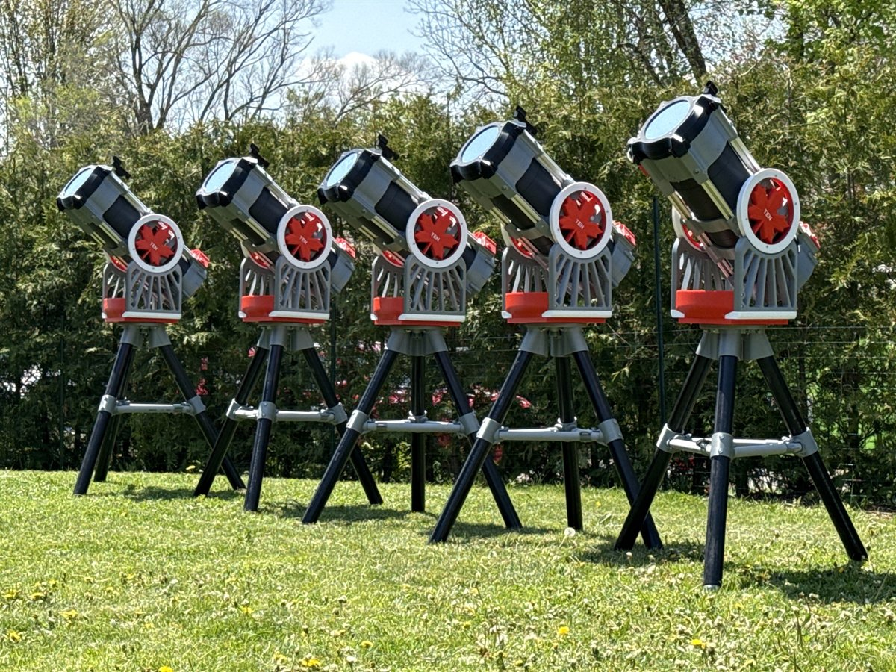

<h1 align="center">Skyward 200</h1>

  <strong>An 8 inch f/4 Newtonian telescope you can 3D print and build yourself.</strong> 
  Build the visual version, or the Skyward 200 Astrograph for astrophotography. 
  Open source, from <a href="https://www.tentelescopes.com">Ten Telescopes</a> in Guelph, Ontario.

  <a href="https://youtu.be/eMQ5uVLKook">Build videos</a> ·
  <a href="https://www.tentelescopes.com/skyward-200">Project page</a> ·
  <a href="https://discord.gg/kwv2z3wfGd">Discord</a> ·
  <a href="https://tundra3d.ca/products/skyward-200-telescope-kit?utm_source=github&utm_medium=referral&utm_campaign=readme">Get a kit</a>

---

The Skyward 200 is the big brother of our [Skyward 150](https://github.com/TenTelescopes/Skyward150), and everything on it is bigger. It comes in two versions: a **visual** version on an elevated Dobsonian rocker box and tripod, and the **Skyward 200 Astrograph**, designed with extra stiffness and printed in a stiffer filament for long exposure astrophotography.

A Skyward is never really finished. It's forever upgradeable, so you can start with the visual version, turn it into an Astrograph later, and go back to visual if you want.

| | |
|---|---|
| **Design** | Newtonian reflector |
| **Primary mirror** | 200 mm (8") parabolic, f/4, 800 mm focal length |
| **Secondary mirror** | 70 mm |
| **Focuser** | [Ten Telescopes 2" focuser](https://github.com/TenTelescopes/Ten-Telescopes-2-Inch-Focuser), Crayford style, EAF ready |
| **Frame** | 3030 aluminum extrusions, 673 mm |
| **Versions** | Visual: elevated Dobsonian rocker box on a tripod. Astrograph: stiffer tube for astrophotography, with a dovetail |
| **Printer** | Needs a 300 x 300 mm bed. ABS or ASA in an enclosed printer is recommended |

> **Not safe for viewing the Sun.**

## Watch the build

  <a href="https://youtu.be/eMQ5uVLKook">
    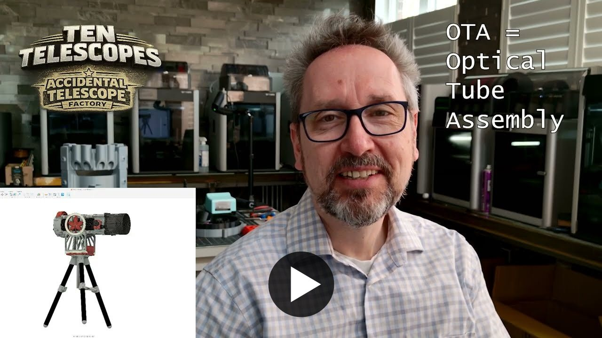
  </a>

The optical tube video is a first draft, posted to help builders while the final version is being edited. Two more videos cover the mount:

<table>
  <tr>
    <td width="50%" align="center">
      <a href="https://youtu.be/xlI4gX7QByU">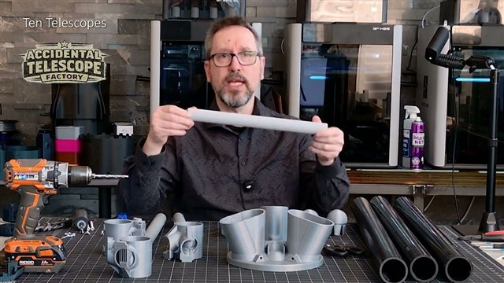</a> 
      <a href="https://youtu.be/xlI4gX7QByU"><strong>Tripod assembly</strong></a> 
      A good warmup before the rest of the build
    </td>
    <td width="50%" align="center">
      <a href="https://youtu.be/_I8nchwFIMY">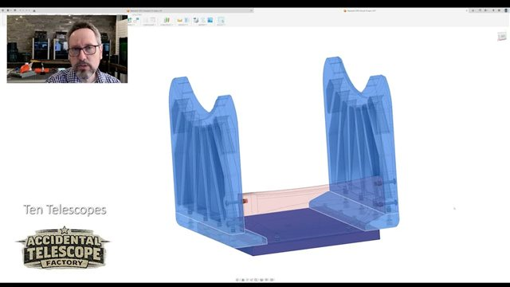</a> 
      <a href="https://youtu.be/_I8nchwFIMY"><strong>Rocker box assembly</strong></a> 
      Heat-set inserts and M5 screws
    </td>
  </tr>
</table>

A full step by step assembly manual is on the way. Read about it in [150 Pages Later: The Skyward 200 Assembly Manual](https://www.tentelescopes.com/post/150-pages-later-the-skyward-200-assembly-manual).

## Start here

1. **Watch the build videos** above to see what's involved.
2. **Check your printer.** The parts need a 300 x 300 mm bed. Calibrate your printer for shrinkage first, so the mirror and other parts fit.
3. **Print the parts.** The STLs are in [`STL Files (alpha status not oriented)`](STL%20Files%20(alpha%20status%20not%20oriented)). They are still alpha and not yet oriented for printing, so lay each one flat in your slicer.
4. **Get the optics and hardware.** Source them yourself, or get the [Skyward 200 complete optics and hardware kit](https://tundra3d.ca/products/skyward-200-telescope-kit?utm_source=github&utm_medium=referral&utm_campaign=readme). It includes the optics, the hardware, a finder and a collimator, plus the flexible TPU parts printed for you.
5. **Ask questions** in [#skyward-build-questions on Discord](https://discord.gg/kwv2z3wfGd). People there have built these.

## Gallery

### The visual Skyward 200

  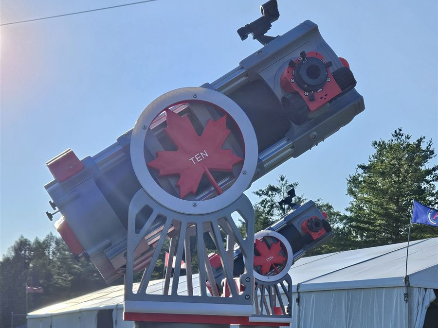
  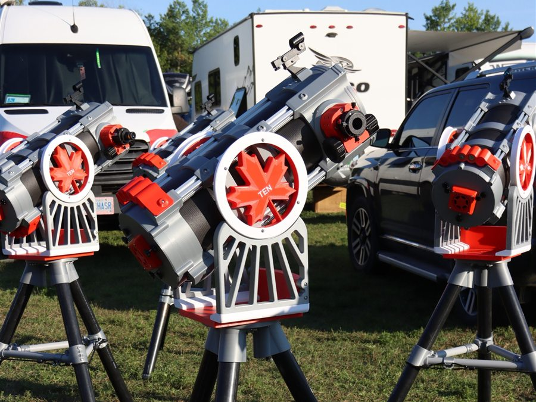
  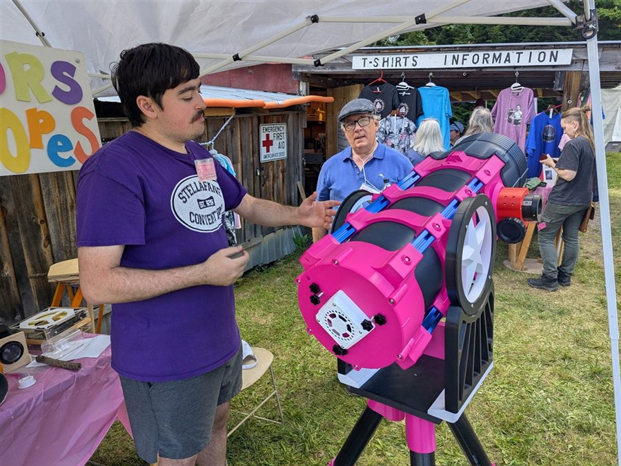

  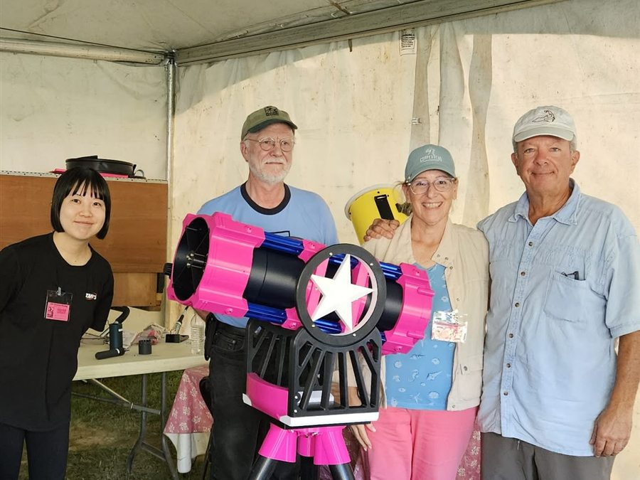
  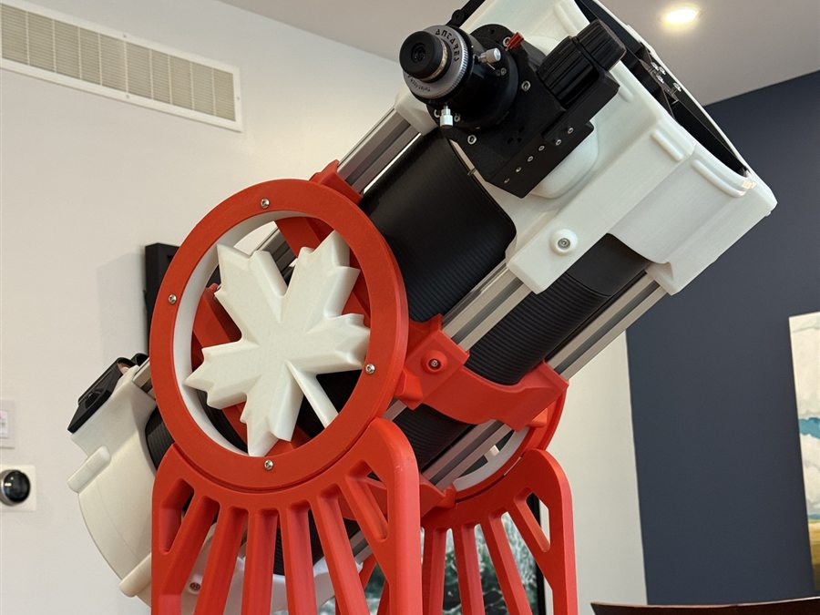
  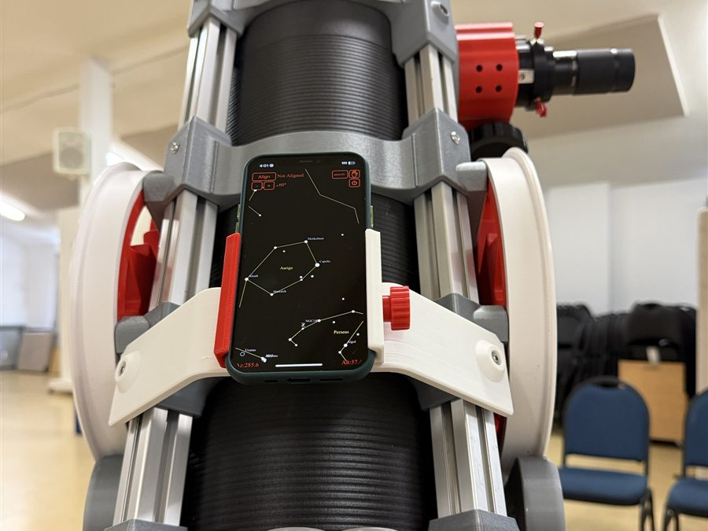

### The Skyward 200 Astrograph

  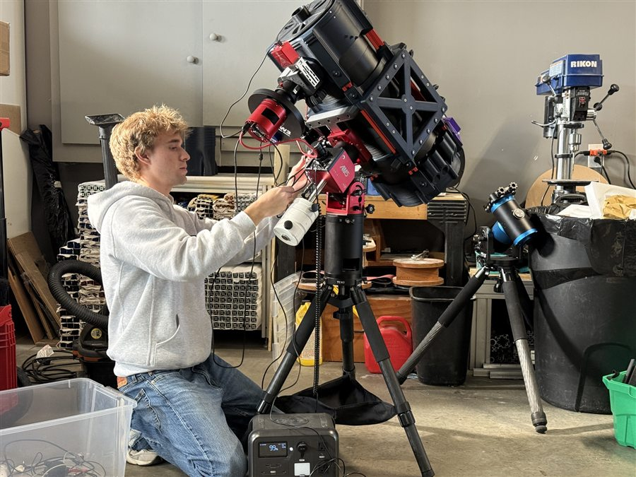
  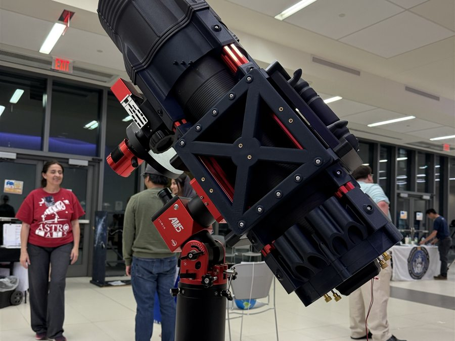
  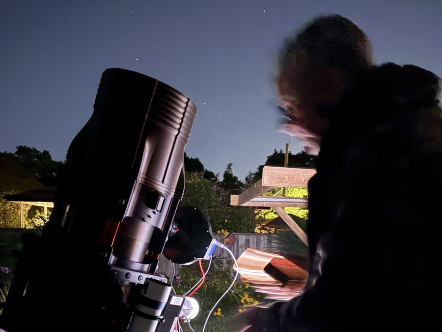

  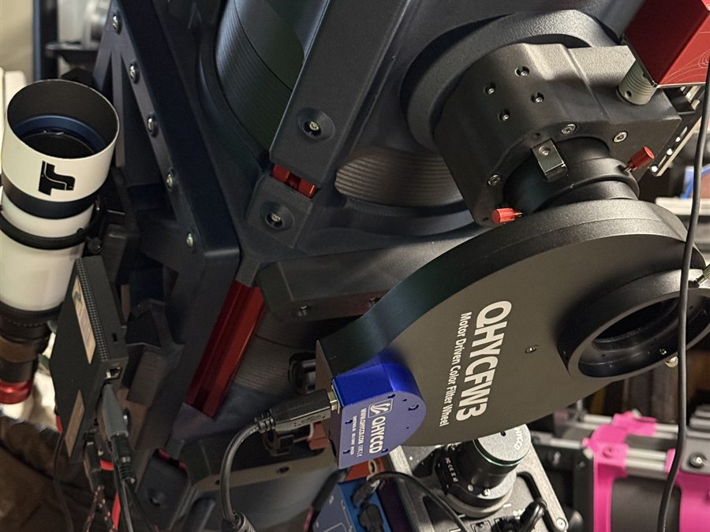
  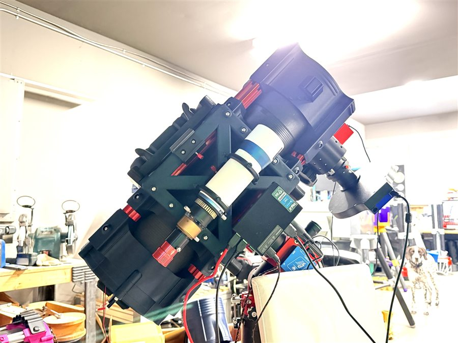
  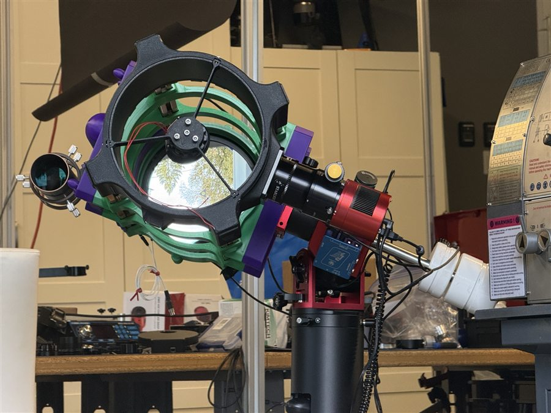

  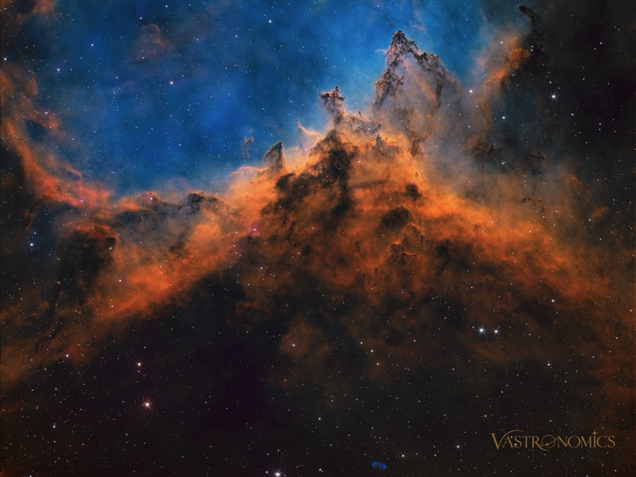
  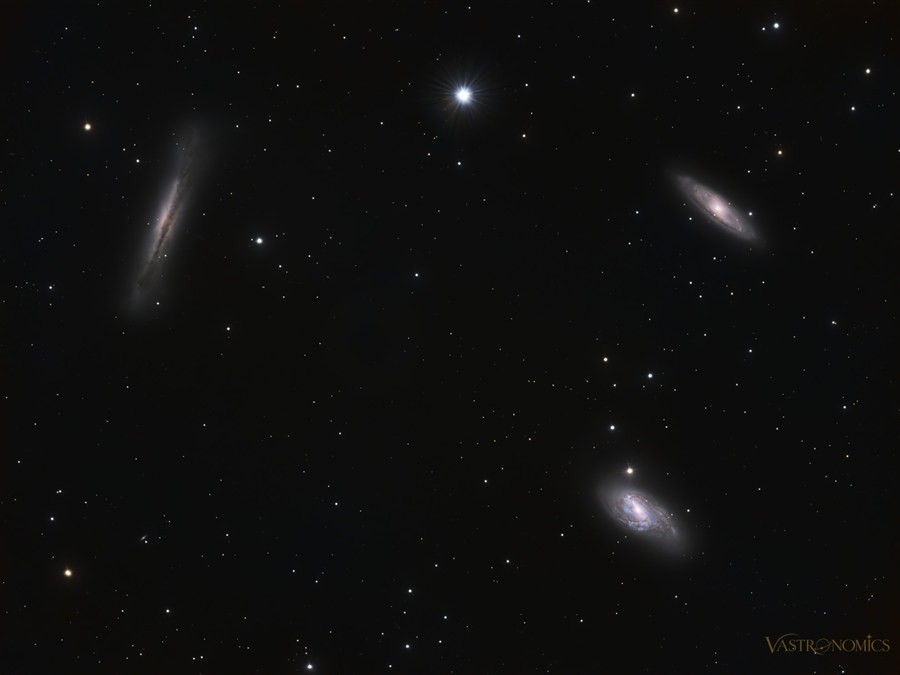
  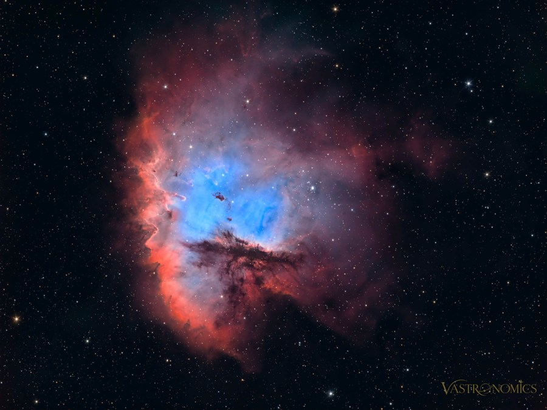

Deep sky images by Vasu Maini with his Skyward 200 f/4 Astrograph: the Heart Nebula (15 hours), the Leo Triplet (2 hours) and the Pac-Man Nebula (about 14 hours).

- See what the Astrograph can do: [Skyward 200 Astrograph: Fifteen Hours on the Heart](https://www.tentelescopes.com/post/skyward-200-astrograph-fifteen-hours-on-the-heart)
- Thirty Skyward 200s for the Young Galileos program: [Building Thirty Future Astronomers](https://www.tentelescopes.com/post/building-thirty-future-astronomers)

Built one? Share it in **#skyward-200-build-logs** on [Discord](https://discord.gg/kwv2z3wfGd).

## What's in this repo

All folders are inside [`STL Files (alpha status not oriented)`](STL%20Files%20(alpha%20status%20not%20oriented)).

| Folder | What's inside |
|---|---|
| [`D200 Visual Scope STLs`](STL%20Files%20(alpha%20status%20not%20oriented)/D200%20Visual%20Scope%20STLs) | The visual version: optical tube, tripod and mount, and accessories such as the phone dock and solar filter frame |
| [`D200 Astrograph Scope STLs`](STL%20Files%20(alpha%20status%20not%20oriented)/D200%20Astrograph%20Scope%20STLs) | The Astrograph: tube, spider, dovetail, baffles, Tri-Bahtinov mask and mounts for a guide scope, mini PC and dew controller |
| [`Mirror Cell for 8 inch Mirrors (203mm)`](STL%20Files%20(alpha%20status%20not%20oriented)/Mirror%20Cell%20for%208%20inch%20Mirrors%20(203mm)) | A mirror cell for 203 mm mirrors |
| [`Bearing Core Design Options`](STL%20Files%20(alpha%20status%20not%20oriented)/Bearing%20Core%20Design%20Options) | Other designs for the altitude bearing cores |

The focuser is in its own repo: [Ten-Telescopes-2-Inch-Focuser](https://github.com/TenTelescopes/Ten-Telescopes-2-Inch-Focuser).

## License

These designs are licensed under the [Creative Commons Attribution–NonCommercial 4.0 International License](https://creativecommons.org/licenses/by-nc/4.0/).

You are free to:
- Download, modify, and use for personal, non-commercial purposes.
- Share adaptations with credit to **Ten Telescopes**.

You may **not**:
- Sell these designs.
- Sell physical products made from these designs without written permission.

For commercial inquiries, contact: admin@tentelescopes.com
